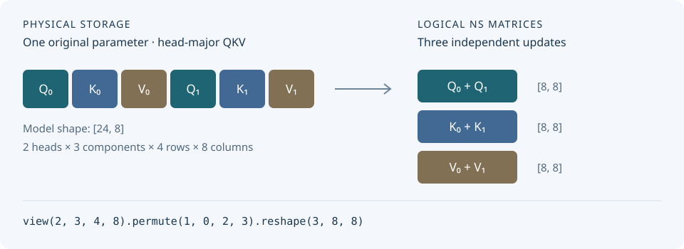

# Matrix Layouts {#matrix-layouts}

<p class="dmuon-lead">Choose which two-dimensional matrices Muon updates inside an existing parameter. Keep the model's modules, parameter names, and forward shapes.</p>

`MatrixLayout` is a configuration attached through `param_policy` or
`param_policy_fn`. It covers fused QKV, individual attention heads, stacked MoE
experts, and interleaved storage without a model-specific adapter.

## The rule: the final two axes form one matrix {#matrix-rule}

After applying the declared layout operations, the **last two dimensions** form
one Newton–Schulz (NS) matrix. Every index in the leading dimensions selects an
independent update with its own momentum and owner assignment.

```python
from dmuon import MatrixLayout

# Physical parameter: [E, 2 * I, H]
layout = MatrixLayout.view(E, 2, I, H)
# Logical updates: 2 * E independent matrices, each [I, H]
```

These are declarations for the optimizer, not instructions to reshape the model
in `forward()`. Different logical matrices can have different owners; a rank may
own several matrices. DMuon's placement policy chooses the assignments.

| Choice | What it controls |
|---|---|
| `route` | Whether a selected parameter uses Muon, AdamW, or sharded AdamW |
| `hook_boundary_predicate` | Where parameters are materialized and communication is grouped |
| `matrix_layout` | Which complete matrices receive independent Muon updates |

## Configure a model {#configure-model}

This example selects fused expert weights explicitly. It leaves other managed
parameters on AdamW so that the layout choices are easy to see. Extend the
policy for attention projections and large embeddings as appropriate for your
training setup; see [Pure DMuon Routing](pure-dmuon-routing.md).

Assume `model` has expert tensors named
`model.layers.N.mlp.experts.gate_up_proj` and `down_proj`. Use your model's actual
fully qualified names. `wrap_decoder_layer` is the same module predicate you use
to select the decoder hook boundaries.

```python
import torch
import dmuon
from dmuon import MatrixLayout

cfg = model.config
E = cfg.num_experts
I = cfg.moe_intermediate_size
H = cfg.hidden_size

dmuon.dedicate_params(
    model,
    mesh,
    predicate=lambda name, p: p.requires_grad,
    hook_boundary_predicate=wrap_decoder_layer,
    param_policy={
        "defaults": {
            "route": "adamw",
            "param_dtype": torch.bfloat16,
            "grad_dtype": torch.bfloat16,
            "master_dtype": torch.float32,
            "optim_dtype": torch.float32,
        },
        "overrides": [
            {
                "name_glob": "model.layers.*.mlp.experts.gate_up_proj",
                "route": "muon",
                "matrix_layout": MatrixLayout.view(E, 2, I, H),
            },
            {
                "name_glob": "model.layers.*.mlp.experts.down_proj",
                "route": "muon",
                "matrix_layout": MatrixLayout.view(E, H, I),
            },
        ],
    },
)

optimizer = dmuon.Muon(model, lr=0.002, adamw_lr=0.0003)
```

The example uses FP32 master weights and optimizer state with BF16 compute and
gradient communication. These precision settings are independent of the layout.
Configure DMuon before `fully_shard()` when combining the two runtimes.

`name_glob` matches the full parameter name using case-sensitive glob patterns.
Overrides apply in order; later matching fields replace earlier ones. It does
not infer a layout from a model name. The existing `name` / `contains` selectors
use substring matching instead.

### Derive dimensions in a callback {#policy-callback}

For layers with different expert sizes, use the selected parameter's shape.
Pass this as `param_policy_fn=expert_policy` **instead of** `param_policy`.

```python
def expert_policy(name, p):
    if name.endswith(".experts.gate_up_proj"):
        experts, twice_i, hidden = p.shape
        return {
            "route": "muon",
            "matrix_layout": MatrixLayout.view(
                experts, 2, twice_i // 2, hidden
            ),
        }
    if name.endswith(".experts.down_proj"):
        return {"route": "muon", "matrix_layout": MatrixLayout.view(*p.shape)}
    return {"route": "adamw"}
```

This callback shows routing and layouts only; include precision fields in the
returned policy to set them as well. The names and axis meanings are the caller's
explicit contract. In this example,
the fused axis must contain equally sized gate and up matrices in that order.

## Fused QKV: together, separately, or per head {#qkv-updates}

For a physical weight `[3 * H, H]` with rows ordered as all Q, then all K,
then all V:

| Intended update | Layout | NS matrices |
|---|---|---|
| Keep fused QKV together | `MatrixLayout.whole()` | One `[3H, H]` matrix |
| Separate Q, K, and V | `MatrixLayout.view(3, H, H)` | Three `[H, H]` matrices |
| Separate each component and head | `MatrixLayout.view(3, num_heads, head_dim, H)` | `3 * num_heads` matrices of `[head_dim, H]` |
| Unequal Q/K/V row counts | `MatrixLayout.rows(q_rows, k_rows, v_rows)` | Three matrices with their respective row counts |

Here `num_heads * head_dim == H`, and the row partitions must cover the entire
parameter. Fused and separate NS updates are different optimizer choices;
DMuon lets the caller choose rather than silently splitting QKV.

For MoE, `view(E, 2, I, H)` separates gate/up within each expert;
`view(E, 2 * I, H)` keeps each expert's gate/up fused. Avoid `whole()` when you
want independent experts: on a 3D tensor it uses the existing interpretation
`[shape[0], product(shape[1:])]`, not one update per expert.

## Interleaved storage {#interleaved}

The layout must describe the actual element order. A shape alone cannot tell
whether QKV is component-major or head-major.

<div class="dmuon-diagram" markdown>



</div>

Suppose `[24, 8]` stores two heads in row order
`Q0, K0, V0, Q1, K1, V1`, with four rows per entry:

```python
# Independent Q, K, and V, combining both heads within each component.
layout = (
    MatrixLayout.view(2, 3, 4, 8)
    .permute(1, 0, 2, 3)
    .reshape(3, 8, 8)
)

# Alternatively, update the six head/component matrices independently.
per_head = MatrixLayout.view(2, 3, 4, 8)
```

`view(3, 8, 8)` would compile for the same physical shape, but it would select
the wrong elements for this head-major storage. Compilation validates coverage
and geometry; the caller must verify the intended Q/K/V ordering.

### Grouped-query attention and column-fused weights {#grouped-query-and-column-layouts}

For two KV groups, each storing two Q heads, one K head, and one V head,
with head dimension 2 and input width 8:

```python
# Physical parameter: [16, 8]
gqa = (
    MatrixLayout.view(2, 4, 2, 8)
    .split((2, 1, 1), dim=1)
    .reshape(-1, 8)
)
# Q: [8, 8]; K: [4, 8]; V: [4, 8]

# QKV stored along columns: physical [8, 24]
column_fused = MatrixLayout.view(8, 3, 8).permute(1, 2, 0)
# Three [8, 8] matrices, with optimizer output/input orientation.
```

After `split`, subsequent operations apply independently to each branch.
Branches are enumerated in split order, then by their leading dimensions.
The declared view/reshape operations preserve logical element order; they do
not promise a zero-copy tensor view at runtime.

## Inspect the update matrices before training {#inspect-layout}

```python
plan = layout.compile((24, 8))
print([matrix.shape for matrix in plan.matrices])
# [(8, 8), (8, 8), (8, 8)]
```

Check names against `model.named_parameters()`, then check shapes and element
ordering against the model's forward implementation. For a small tensor filled
with `arange`, `plan.pack(tensor)` exposes which elements enter each logical
matrix; `plan.unpack(...)` restores their original order.

Run the CPU examples from the repository root:

```bash
PYTHONPATH=. python examples/matrix_layouts.py
```

## How the CUDA copy path fits in {#cuda-copy}

The layout compiler produces address metadata. It does not add a model module
or create one CUDA kernel per expert. At a wrapping boundary, DMuon batches
compatible conversion and layout tasks into a copy launch on the caller's stream.

| Phase | Operation |
|---|---|
| Weight copy-in | Convert owner master weights directly into DMuon's communication buffer; contiguous FP32→BF16/FP16 uses vector loads and packed stores. |
| Native layout restoration | After broadcast, restore interleaved or transposed data into the model's native buffer on the broadcast stream. Contiguous logical matrices can use native buffer views. |
| Gradient preparation | Borrow compatible contiguous gradients, or gather/convert directly into reduction inputs. Muon still updates complete logical matrices on their owners. |

The compute stream waits for the parameter-ready event before use. Prefetching
and layout restoration share the broadcast stream. Copies and communication
may overlap with other work, so their accumulated kernel times do not equal
their contribution to whole-step time.

### Installation and defaults {#build-and-backends}

With CUDA-enabled PyTorch and a CUDA toolkit installed, the layout-copy
extension builds by default alongside the other optional CUDA extensions.
Use the normal installation command; no build environment variable is needed:

```bash
pip install -e . --no-build-isolation
```

CUDA is selected automatically for supported FP32, FP16, and BF16 copies when
the extension is available; otherwise DMuon uses the Torch reference path.
No backend setting is required for normal training.

Only set `DMUON_BUILD_LAYOUT_COPY=0` when you explicitly want to disable this
extension. This does not disable the separate fast-clip extension.

??? info "Advanced: comparison and performance debugging"

    | Setting | Meaning |
    |---|---|
    | `DMUON_COPY_BACKEND=auto` | Default automatic selection described above. |
    | `DMUON_COPY_BACKEND=torch` | Force the reference path for comparison or debugging. |
    | `DMUON_COPY_BACKEND=cuda` | Require the CUDA path; raise an error when unavailable. |
    | `DMUON_COPY_MAX_CTAS=96` | Default maximum blocks per copy launch; also capped by the device SM count and available tiles. |

    The CTA budget limits a copy launch; it does not reserve SMs or cap all
    communication kernels. The default was selected on a 132-SM device and can
    be adjusted for other workloads.

## Scope and checkpoints {#scope-and-checkpoints}

Explicit layouts currently require materialized, contiguous, non-TP parameters,
the Muon route, and owner-broadcast forward placement in FSDP2/HSDP. Configure
them before DTensor/TP placement. This feature does not add layout support to
the DDP setup functions or the experimental Muon all-gather placement.

Use the same layout declarations on every rank.

Model checkpoints keep the original parameter names and shapes. Optimizer
checkpoints store each logical matrix's state and layout signature; loading an
optimizer state with a different matrix boundaries or element mapping is rejected.
Keep the same layout when resuming, and use DMuon's
[checkpoint helpers](checkpoint.md).
